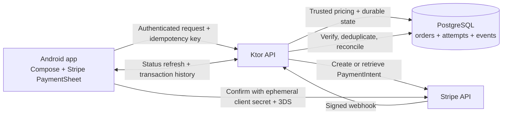
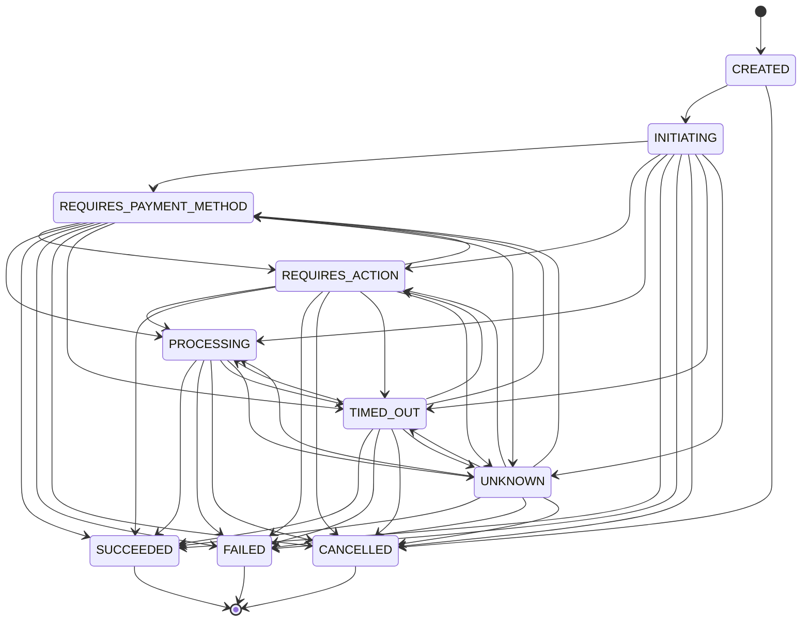
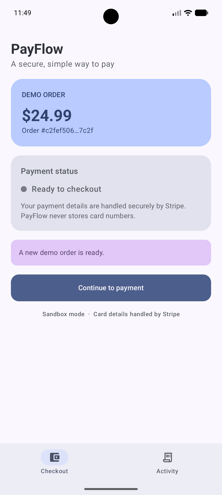
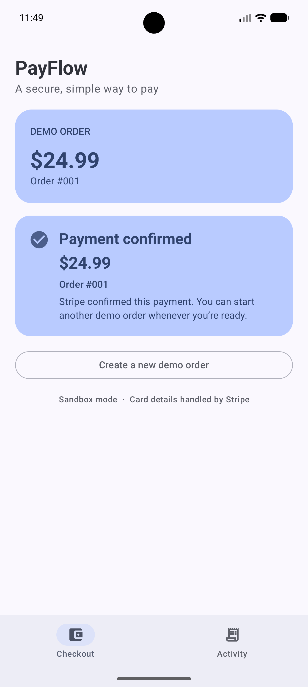
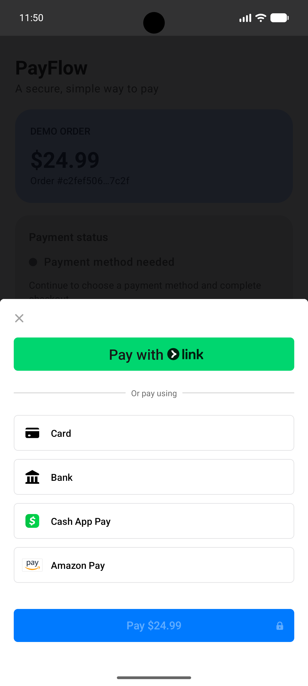
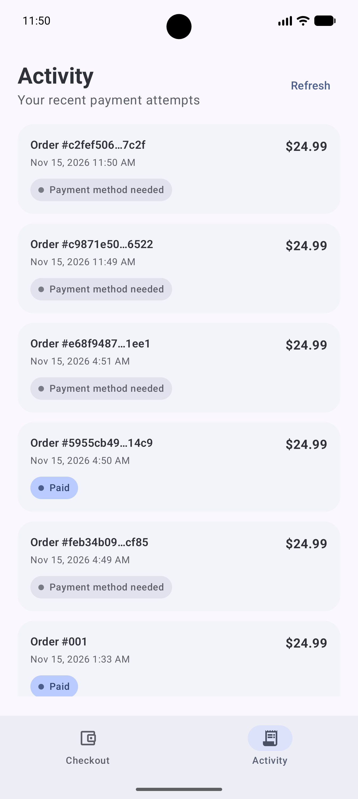

# PayFlow

PayFlow is an independent payment checkout demonstration built with Kotlin Multiplatform, Jetpack Compose, Ktor, PostgreSQL, and Stripe PaymentSheet. It focuses on payment lifecycle handling, idempotency, authentication challenges, webhooks, and recovery.

## Local setup

### Requirements

- Android Studio, Android SDK Platform 37, and JDK 21
- Docker Desktop with Docker Compose
- A Stripe sandbox and the [Stripe CLI](https://docs.stripe.com/cli/install)

### 1. Configure Stripe and local authentication

In the Stripe **sandbox** used for this project, open **Developers → API keys**. Copy the sandbox publishable key (`pk_test_…`) and secret key (`sk_test_…`); they must come from the same sandbox. The publishable key is used by the Android app, while the secret key stays on the backend. See the [Stripe API key guide](https://docs.stripe.com/keys).

Copy the backend template and edit the local copy:

```bash
cp backend/.env.example backend/.env
```

Set `STRIPE_SECRET_KEY` in `backend/.env`. Generate a development-only bearer token:

```bash
openssl rand -hex 32
```

Put the generated value in `PAYFLOW_DEV_BEARER_TOKEN` in `backend/.env`; you will use the same value for the Android app in step 3.

### 2. Start PostgreSQL, Stripe webhooks, and the backend

Authenticate the Stripe CLI once, then leave this listener running in its own terminal. Copy the printed `whsec_…` value into `STRIPE_WEBHOOK_SECRET` in `backend/.env`:

```bash
stripe login
stripe listen --forward-to localhost:8080/v1/webhooks/stripe
```

In another terminal, start the database and API:

```bash
docker compose --env-file backend/.env up -d payflow-postgres
./backend/run-local.sh
```

The backend listens on port **8080** by default. Keep the webhook forwarding URL, Android API URL, and `PAYFLOW_PORT` in sync if you change it.

### 3. Configure the Android app

Create or edit `~/.gradle/gradle.properties` and add the matching sandbox publishable key and the same local bearer token:

```properties
PAYFLOW_API_BASE_URL=http://10.0.2.2:8080/
STRIPE_PUBLISHABLE_KEY=pk_test_...
PAYFLOW_DEV_BEARER_TOKEN=<same-local-token-as-backend>
```

`10.0.2.2` lets the Android emulator reach your computer. On a physical device, use your computer's reachable LAN address and ensure it can access the backend.

### 4. Build and run

Open the project in Android Studio, sync Gradle, start an emulator, and run the `androidApp` configuration. Or install from a terminal:

```bash
./gradlew :androidApp:installDebug
```

Use Stripe's test card `4242 4242 4242 4242`, any future expiry date, and any CVC. Sandbox payments do not move real money.

## Architecture



- **`shared`** contains payment models, lifecycle rules, use cases, and provider contracts without Android, Stripe, Retrofit, or DI framework dependencies.
- **`androidApp`** contains the Compose UI, Navigation Compose destinations, ViewModels/StateFlow, Hilt wiring, Retrofit client, and Stripe SDK adapter.
- **`backend`** contains the Ktor API, PostgreSQL repository, Stripe gateway, authentication, and webhook verification.

### Payment states and retry behavior



The client retains an idempotency key for ambiguous retries. The backend scopes it to the owner and derives a stable Stripe idempotency key, so a repeated request resumes the same attempt. A timeout is not proof of failure: PayFlow reconciles the existing attempt with Stripe before allowing a new attempt. A fresh key is used after a confirmed failed or canceled attempt.

## Tests and continuous integration

GitHub Actions runs the shared, Android, backend unit, and PostgreSQL integration tests on pushes and pull requests:

```bash
./gradlew :shared:allTests \
  :androidApp:testDebugUnitTest \
  :backend:test
```

The backend integration tests cover concurrent idempotent requests, duplicate and out-of-order webhooks, owner isolation, and database state after a Stripe provider outage. They use a PostgreSQL database and a mocked Stripe gateway. To run them locally, set `PAYFLOW_TEST_DATABASE_URL`, `PAYFLOW_TEST_DATABASE_USER`, and `PAYFLOW_TEST_DATABASE_PASSWORD`; without the database URL, that integration test class is skipped.

## Project scope and security

This is a sandbox demonstration, not a deployed payment product. It has no Android sign-in or production session implementation: the local app uses a debug-only in-memory bearer token. The backend includes OIDC validation configuration, but a production mobile auth flow, deployment, and operational controls are outside this project.

The shared Kotlin module targets Android and JVM by default. iOS framework targets can be enabled with `PAYFLOW_ENABLE_IOS_TARGETS=true`, but this repository does not include an iOS application. The project is presented as an Android checkout with a shared Kotlin payment domain.

`backend/.env`, `~/.gradle/gradle.properties`, and `local.properties` must stay out of Git. Stripe secret keys and webhook signing secrets belong only in local backend configuration or a production secret manager. If a key is exposed, rotate it in Stripe.

## Screenshots and demo

| Checkout | Payment confirmed |
| --- | --- |
|  |  |

| Stripe PaymentSheet | Payment activity |
| --- | --- |
|  |  |

[Watch the 75-second checkout walkthrough](docs/screenshots/payflow-demo.webm) (WebM).
